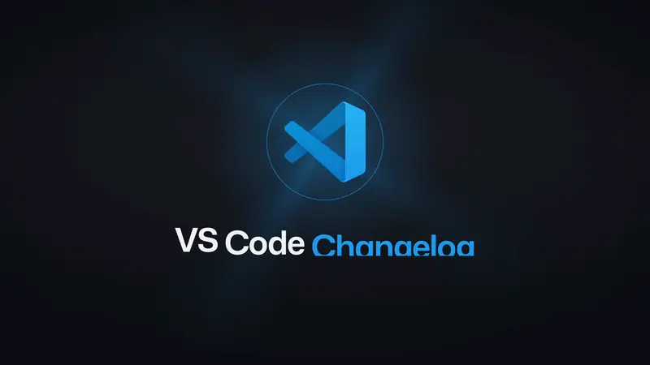

# vscode-release-notes-film

**The VS Code changelog of Monday, October 26, 2026, as a film**, with everything that made it, so it renders again
from a clone, and a template to make the next one with its release notes.

<a href="https://github.com/federicobrancasi/vscode-release-notes-film/releases/download/2026-10-26/VSCode-Changelog-2026-10-26-1080p60.mp4"></a>

**[▶ Watch](https://github.com/federicobrancasi/vscode-release-notes-film/releases/download/2026-10-26/VSCode-Changelog-2026-10-26-1080p60.mp4)** ·
[music only](https://github.com/federicobrancasi/vscode-release-notes-film/releases/download/2026-10-26/VSCode-Changelog-2026-10-26-music-1080p60.mp4) ·
[release notes](https://github.com/federicobrancasi/vscode-release-notes-film/releases/tag/2026-10-26) ·
[what each change shows](skills/generate-changelog-film/example/2026-10-26/README.md)

61 s, the top ten of the day's #changelog report:
- 01 The agent can now design your chat background
- 02 Shared environments get a Delete action
- 03 Remote Environments management, on by default
- 04 In the Agents window, diffs default to cards
- 05 Cancel a connector while it connects
- 06 Cloud models show their real context sizes
- 07 Reviews of agent edits stay in sync
- 08 Pull requests in a chat share one pill
- 09 Relative links open from the chat's folder
- 10 Steering HydraFusion no longer looks stuck

Each is recorded in VS Code, drawn from the scene library, or a card, under a Liquid Glass lens, as one short line
names it, cut on the beat of an original theme.

## Render it again

The film's episode (`film/episode/`), its two recordings (`film/public/screens/2026-10-26/`) and its narration
(`film/public/voice/2026-10-26.wav`) are in the repo, so a clone renders the same film:

```sh
cd film
npm ci              # the film's packages (Remotion, React)
npm run music       # fits the theme to the edit (uv installs its Python packages on demand)
npm run studio      # watch it in the Remotion Studio (the Film composition), or:
npm run master      # the masters, ~10 min: out/VSCode-Changelog-2026-10-26-1080p60.mp4 and -music-1080p60.mp4
```

`npm run master` renders the film three times and votes frame by frame. It then masters both cuts to −14 LUFS and
checks them (9/9). It needs macOS or Linux, Node.js 20+, ffmpeg and uv. None of it needs a sign-in or the engine.

What made each piece is in [skills/generate-changelog-film/example/2026-10-26/](skills/generate-changelog-film/example/2026-10-26/README.md):
- `film.json` (the words and choices), `facts.md` (what each change is, from its PR) and `notes.md` (every decision,
  and what the review found);
- the two recordings' scripts;
- the release notes.

## Make the next one

This repo is a template. **Use this template** → a new repo for the next day (or a release), then:

1. **Set up**: `node scripts/setup.mjs` (it needs the changelog-videos plugin, `gh` signed in to read the report, and VS
   Code Insiders signed in to record chat and the Agents window).
2. **Make the film**: ask an agent with this repo open "make today's changelog film" (or "the changelog film for
   2026-11-02"). It follows [generate-changelog-film](skills/generate-changelog-film/SKILL.md): the report's top ten,
   `facts.md`, `film.json`, the voice, the recordings, the review, the master. It delivers to
   `~/Downloads/changelog-videos/changelog-<date>-film/`.
3. **Keep its kit**: copy the project's `film.json`, `facts.md`, `notes.md`, `picks.json`, `merged.json`, `demos/`,
   `film/episode/` and the day's media into `skills/generate-changelog-film/example/<date>/`, as this one is. Install
   the episode in `film/` too, so the new repo renders it from a clone.
4. **Write the release notes**: ask the agent "write the release notes for this film". It follows
   [write-release-notes](skills/write-release-notes/SKILL.md):
   - it writes `release-notes.md` from the kit alone (each change: what users see, its PR, how the film shows it);
   - it publishes the GitHub release with both cuts and the contact sheet.
   [This film's](skills/generate-changelog-film/example/2026-10-26/release-notes.md) are the model.
5. **Update this README's top** to the new film, and commit.

## How it works

The daily VS Code changelog as a film:
- about a minute on the top ten changes of the #changelog report;
- each change shown in VS Code under a Liquid Glass lens, as one short line names it;
- cut on the beat of its own theme, and reviewed frame by frame;
- delivered narrated and music-only.

- **Built on changelog-videos.** The [changelog-videos](https://github.com/microsoft/vscode-team-kit) plugin's engine
  reads the report, downloads each PR and the build, records VS Code (the Agents window included) and voices the
  lines. This repo makes the film.
- **Recorded or drawn.** A change VS Code can show is recorded. One it can't (an enterprise policy, another OS, the
  web, a sign-in, an update) is drawn from a library of 28 scenes. Each scene is a piece of VS Code 1.144 acted out
  under the lens: see `npm run gallery`.
- **Oct 19 is the standard.** The film the skill was made from: [its kit](skills/generate-changelog-film/example/2026-10-19/README.md)
  and [Oct 23's](skills/generate-changelog-film/example/2026-10-23/README.md) are here too, each with what renders it
  again.

## The repo

| Path | What |
|------|------|
| `skills/generate-changelog-film/` | The skill that makes a film: [SKILL.md](skills/generate-changelog-film/SKILL.md), [film.md](skills/generate-changelog-film/film.md) (the grammar and `film.json`), [scenes.md](skills/generate-changelog-film/scenes.md) (the library), [style.md](skills/generate-changelog-film/style.md) (the rules), and `example/`: Oct 19 (the standard), Oct 23, and Oct 26 (this repo's film) |
| `skills/write-release-notes/` | The skill that writes a film's release notes and publishes its GitHub release |
| `film/` | The Remotion project: `src/` (the shell, the change grammar and the lens, the UI kit and the scenes), `scripts/` (one per command), `assets/` (the theme), `public/` (fonts, the icon, sound effects, grain, and this film's recordings and narration) and `episode/` (this film's edit) |
| `scripts/setup.mjs` | The engine's top-ten copy, the film's home (the voice at the film's pace), the packages |
| `docs/media/` | The films' animated previews |

## Licences

MIT. The fonts, codicons and the VS Code icon have their own terms, and the theme and sound effects were made for the
film; see [NOTICE](NOTICE). The narration is MAI-Voice-2, an AI voice.

**Rendering uses [Remotion](https://remotion.dev).** It's free for individuals and small teams, and needs a company
licence otherwise ([remotion.dev/license](https://remotion.dev/license)).
