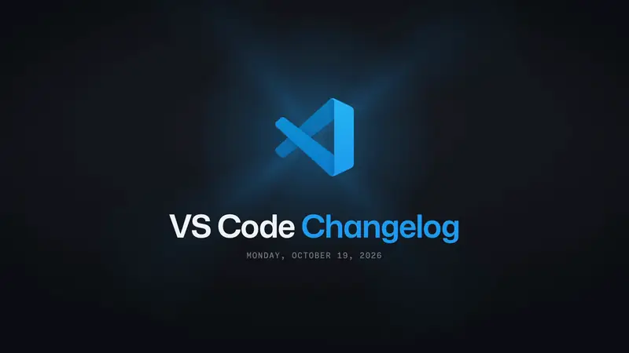

# The standard: Oct 19, 2026

The film Federico called final: [contact.png](contact.png). Ten changes, 59 s, 118 beats at 120 BPM, narrated by
MAI-Voice-2 at pace 1.2.

**[▶ Watch](https://github.com/federicobrancasi/changelog-film/releases/download/films-v1/VSCode-Changelog-2026-10-19-1080p60.mp4)** ·
[music only](https://github.com/federicobrancasi/changelog-film/releases/download/films-v1/VSCode-Changelog-2026-10-19-music-1080p60.mp4)

## What each change shows

| # | Change | Shown with | Why |
|---|--------|-----------|-----|
| 01 | Signed out? The Welcome page offers GitHub sign-in | `button-swap`, the label rolling on "GitHub" | Signed out isn't recordable while signed in |
| 02 | Session rows lead with New Nested Session | recording `c2`, the lens on the session list's top | The Agents window, signed in |
| 03 | The app icon now shows the badge | `app-badge`, the badge on "badge" | The Dock is outside the recorded window |
| 04 | /fork, with a title or with a prompt | recording `c4`, the lens on the chat input and its menu | |
| 05 | Plugin links that ask before they act | recording `c5`, the lens on the dialog | |
| 06 | Save a whole image batch as one ZIP | `list-actions`, hovered on "batch", clicked on "ZIP" | Generating images costs credits |
| 07 | Language Status says when diagnostics are cut | recording `c7`, the lens on the status bar's end and its hover | |
| 08 | Removed steering messages stay removed | `queued-message`, removed on "message", done on "never" | Queuing needs a working agent |
| 09 | Cloud Sandbox sessions keep their model picker | `picker` with `loads`, back on "model", opened on "back" | Cloud Sandbox isn't in the build |
| 10 | Find sessions by pull request number | `sessions-find`, Find on "find", typed on "session" and "number" | Sessions with pull requests |

## The files

| File | What |
|------|------|
| [film.json](film.json) | The film's words and choices: the model for a day's |
| [facts.md](facts.md) | What each change is, from its PR (the engine project's) |
| [picks.json](picks.json), [merged.json](merged.json) | The report's ten picks, and the day's 49 merges |
| [demos/](demos) | The four recordings' scripts. They were paced to the changelog video's longer narration, so `film.json` sets each recording's `from`; a new day's paces to the film's own line (film.md) |
| [episode/](episode) | What `npm run episode` made: the episode, the narration's timing and the edit (setup installs them) |
| [media/](media) | The recordings and the narration (setup installs them) |

## What review found, and the rules it left

Five rounds made the film; [style.md](../../style.md) is what they decided.

- The lens moved between small controls, so now it sits on the whole block, once.
- The glass had a haze, a glint and a doubled copy as it opened, so now nothing is drawn over the magnified UI.
- The title said "Stable", so now no build words are allowed.
- There were black bars, a flicker and a closing slide. The frame is full, and the film ends on the end card.
