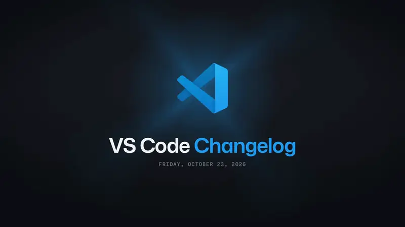

# A day the skill made: Oct 23, 2026

The first day the skill made on its own, from its docs: [contact.png](contact.png). It has ten changes, runs 60 s (120 beats at 120 BPM), and is narrated by MAI-Voice-2 at pace 1.2.

**[▶ Watch](https://github.com/federicobrancasi/changelog-film/releases/download/films-v1/VSCode-Changelog-2026-10-23-1080p60.mp4)** ·
[music only](https://github.com/federicobrancasi/changelog-film/releases/download/films-v1/VSCode-Changelog-2026-10-23-music-1080p60.mp4)

## What each change shows

| # | Change | Shown with | Why |
|---|--------|-----------|-----|
| 01 | Share this machine as a GitHub environment | Recording `c1`: the new setting in the Settings editor, the pointer on its row on "GitHub" | |
| 02 | Voice Mode can answer how your sessions are going | Recording `c2`: the new setting, the pointer on its row on "tell" | Voice Mode itself needs an OpenAI key |
| 03 | Terminal sign-ins open in front of VS Code | `windows` with a terminal running `Connect-AzAccount`, its sign-in prompt opening in front on "sign-in" | Windows only |
| 04 | Agent Host moves to Copilot SDK 1.0.26 | `card` | Nothing changes on screen |
| 05 | Turn a tool off once: it's off everywhere | `card` | A state shared across windows |
| 06 | A new layout for starting a session | Recording `c6`: the Agents window's new session composer, an idea typed on "new" | |
| 07 | Agents can organize your Sessions list | `sessions-organize` (added that day): it reads on "agent", organizes on "tidy", and the list changes on "does" | It needs a model's credits |
| 08 | Voice Mode steers the work in progress | `card` | Voice Mode needs an OpenAI key |
| 09 | Computer Use setup, one permission at a time | `dialog` with rows: Allow in Settings on "asks", then the next permission is current | It needs Computer Use and macOS permissions |
| 10 | MCP allowlists check commands before names | `notification`: the error a user gets, in the PR's words, on "MCP" | The allowlist "is not surfaced to end users" |

## How it differs from Oct 19

- **Its recordings are paced to the film's own lines.** Each demo was recorded after `prs voice`, with `cue()` on the line's words, so `film.json` sets no `from`.
- **Three changes are cards**, for changes with nothing to show on screen.
- **The scenes are the library's, with the PR's strings.** `windows`, `dialog`, `notification` and the new `sessions-organize` each gained what this day needed. [notes.md](notes.md) has every decision and what the two review rounds found.

## The files

| File | What |
|------|------|
| [film.json](film.json) | The film's words and choices |
| [facts.md](facts.md) | What each change is, from its PR |
| [notes.md](notes.md) | The run's decisions, and what its review found |
| [picks.json](picks.json), [merged.json](merged.json) | The report's ten picks, and the day's 138 merges |
| [demos/](demos) | The three recordings' scripts, each paced to its line |
| [episode/](episode) | What `npm run episode` made: the episode, the narration's timing and the edit |
| [media/](media) | The recordings and the narration |

To render it again:
1. Copy `episode/` to `film/episode/`, and `media/` into `film/public/`.
2. Run `npm run music`.
3. Open it with `npm run studio`, or render the masters with `npm run master`.

It was made at commit `019ad7b`; later changes to the scenes can draw it a little differently.
